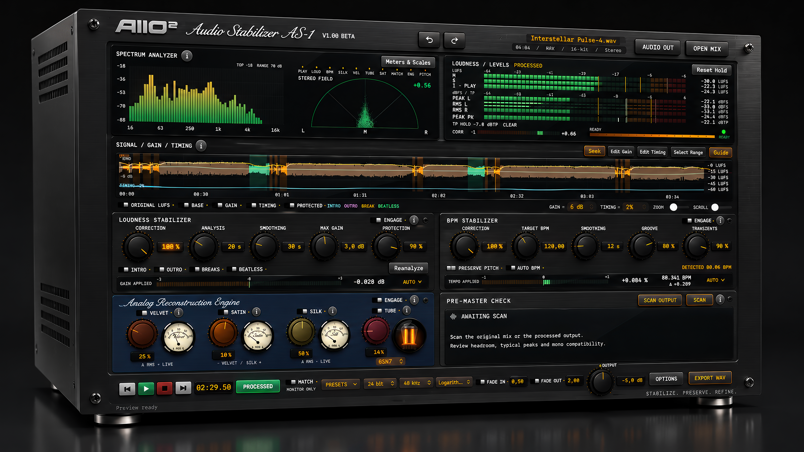

# AIIO² Audio Stabilizer

### Dedicated Pre-Master Audio Processor

**STABILIZE. PRESERVE. REFINE.**

*Hardware-inspired software. Designed for sound.*

**Less Digital. More Music.**

[Releases](../../releases) · [Bug Reports](../../issues) · [Contact](mailto:RonnyK.1980@icloud.com)

---

## Overview

AIIO² Audio Stabilizer is a dedicated standalone 
pre-master audio processor for macOS, combining 
intelligent loudness stabilization, adaptive tempo 
correction, advanced signal analysis and a proprietary 
analog-inspired sound processing architecture.

Its purpose is not to master your music.

Its purpose is to give your mastering chain a better 
starting point.

Audio Stabilizer focuses on preserving musical dynamics, 
improving structural consistency and refining unwanted 
digital sound characteristics before the final 
mastering stage.

All audio processing takes place locally on your Mac.

---

## Development Philosophy

The development of Audio Stabilizer began with a 
practical problem encountered while producing music 
with modern generative audio systems.

Even musically impressive productions can contain 
inconsistent loudness, subtle tempo drift, unstable 
spectral textures and unwanted digital harshness.

Conventional mastering processors are not necessarily 
designed to address these problems at their source.

Audio Stabilizer was developed to approach them 
differently.

Rather than forcing audio into a predefined loudness 
target or applying conventional frequency correction, 
its processing architecture is designed to work with 
the existing musical material.

Although originally inspired by the challenges of 
AI-generated music, Audio Stabilizer is designed for 
both conventional and AI-assisted music production.

---

## The Analog Reconstruction Engine

The proprietary Analog Reconstruction Engine (ARE) 
is the sonic core of Audio Stabilizer.

Four complementary processors combine adaptive 
spectral processing, nonlinear signal shaping and 
analog-inspired characteristics within a dedicated 
signal processing architecture.

Unlike a conventional equalizer, which primarily 
changes the amplitude of selected frequency regions, 
the ARE responds to the spectral structure, dynamics 
and energy distribution of the incoming signal.

Its objective is to refine the existing material 
without unnecessarily sacrificing musical detail.

### VELVET

**Weight. Foundation. Substance.**

An analog-inspired nonlinear processing stage designed 
to enhance the perceived body and coherence of the 
low-frequency material.

- Nonlinear line-stage processing
- Push-pull bass architecture
- Subtle harmonic enrichment
- Enhancement of existing low-frequency content
- No synthetic sub-bass generation

### SATIN

**Texture. Balance. Character.**

A bipolar midrange refinement processor providing 
continuous control between two complementary sonic 
characteristics.

- Negative values: warmer, VELVET-inspired character
- Positive values: smoother, SILK-inspired character
- Neutral position: bypass
- Signal-dependent processing rather than conventional EQ

### SILK

**Clarity without unnecessary harshness.**

SILK uses adaptive, multi-stage spectral processing 
designed to address unwanted digital roughness, 
unstable spectral textures and excessive harshness.

Its approach differs fundamentally from conventional 
noise-profile-based spectral denoising.

Rather than treating unwanted spectral components 
solely as noise to be removed, SILK evaluates the 
behavior and structure of the musical signal itself.

- Adaptive spectral refinement
- Signal-dependent processing
- Transient and harmonic protection
- Reduction of perceived digital harshness
- Preservation of musical character

SILK is not intended to replace specialized audio 
restoration tools. Severely damaged recordings or 
persistent noise may still require dedicated spectral 
denoising or restoration.

### THERMIONIC / TUBE

**Harmonics. Depth. Analog-inspired character.**

A dynamic nonlinear processing architecture inspired 
by the sonic characteristics of classic vacuum tube 
circuits.

Four distinct tube-inspired profiles are available:

- 12AU7
- 12AX7
- 6SN7
- 300B

The processing incorporates dynamic saturation, 
shared stereo energy behavior, sag-inspired response 
and adaptive mid/side characteristics.

These profiles are original digital interpretations, 
not measured reproductions of specific hardware units.

### Processing Architecture

The ARE incorporates:

- Adaptive spectral processing
- Nonlinear harmonic processing
- 8x oversampling in designated nonlinear stages
- Residual-based processing architecture
- Double-precision calculations in relevant DSP stages
- Independent module activation
- Global ARE bypass

---

## Loudness Stabilizer

Unlike conventional loudness normalization or dynamic 
range compression, the Loudness Stabilizer is designed 
to reduce unwanted long-term level inconsistencies 
between comparable musical sections.

It does not force the entire track toward a fixed 
LUFS target.

Dedicated arrangement protection helps preserve 
intentional musical contrasts, including:

- Introductions
- Outros
- Breaks
- Beatless sections

Adjustable analysis, correction, smoothing and gain 
limits allow the stabilization behavior to be adapted 
to the individual production.

---

## BPM Stabilizer

Designed to address subtle tempo drift and unwanted 
timing inconsistencies while retaining musical movement.

- Automatic tempo analysis
- Automatic or manually selected target BPM
- Adjustable correction strength
- Tempo smoothing
- Groove preservation controls
- Transient protection
- Optional pitch preservation
- Manual timing curve editing

The BPM Stabilizer is not intended to quantize every 
musical event to a rigid timing grid.

---

## Precision Audio Analysis

Audio Stabilizer provides an integrated environment 
for evaluating both the original and processed signal.

- Real-time spectrum analyzer
- Stereo field visualization
- Stereo correlation analysis
- Momentary and short-term loudness
- Playback-integrated loudness
- True-peak metering
- Peak and RMS metering
- Interactive signal visualization
- Editable gain and timing curves
- Level-matched A/B monitoring

---

## Pre-Master Check

A dedicated offline analysis system evaluates the 
original mix or processed output before export.

The Pre-Master Check focuses on:

- Available headroom
- True-peak levels
- Typical signal peaks
- Potential overload conditions
- Mono compatibility
- Output gain recommendations

The objective is to identify technical conditions 
that may affect subsequent mastering.

A successful check is not a guarantee of mastering 
quality or universal playback compatibility.

---

## User Interface

A hardware-inspired rack interface brings all major 
processing and analysis modules together in a single 
workspace.

No plugin chains. No unnecessary windows. 
No complex routing.

---

## Audio Export

- Stereo WAV export
- 16-bit PCM
- 24-bit PCM
- 32-bit floating-point
- Original or selectable output sample rate
- Output sample rates up to 192 kHz
- Optional TPDF dithering for integer PCM
- Adjustable output gain
- Configurable fade-in and fade-out
- Multiple fade characteristics

The exported audio is intended for further mastering 
or other subsequent production stages.

---

## What Audio Stabilizer Is Not

Audio Stabilizer deliberately avoids conventional 
final-stage mastering processors.

It does not contain:

- A conventional mastering equalizer
- A multiband mastering compressor
- A loudness maximizer
- A brickwall limiter

These creative and technical decisions remain with 
the mastering engineer.

Audio Stabilizer prepares the signal.

Your mastering chain completes it.

---

## System Requirements

| Requirement | Specification |
|---|---|
| Operating system | macOS 14 or later |
| Processor | Apple Silicon |
| Architecture | Native ARM64 |
| Application type | Standalone |
| Audio processing | Stereo |
| Export format | WAV |
| Internet connection for audio processing | Not required |
| Account or activation | Not required |

Intel Macs, Windows and Linux are not currently 
supported.

---

## Public Beta

### V1.00 PUBLIC BETA

The first public version of AIIO² Audio Stabilizer 
is provided free of charge under its proprietary 
beta license.

The application is intended for personal and 
professional evaluation and music production.

This is an early public release. Unexpected behavior 
and compatibility limitations may occur.

### Downloads

Official application releases will be available in 
the [Releases](../../releases) section.

### macOS Security Notice

The Public Beta is ad-hoc signed but is not currently 
notarized by Apple.

macOS may therefore display security warnings when 
opening the application for the first time.

Please consult the included installation instructions 
and only obtain the application from its official 
release page.

Do not globally disable macOS security protections.

---

## Documentation

The comprehensive English User Manual covers:

- Installation and initial setup
- Complete interface overview
- Individual processing modules
- Analog Reconstruction Engine
- Signal processing principles
- Audio analysis and metering
- Gain and timing curve editing
- Pre-Master Check
- Audio export
- Technical specifications
- Recommended production workflows

The manual is included in the official release package.

---

## Privacy

Audio processing is performed locally.

The application is designed to operate without:

- Cloud-based audio processing
- User registration
- Online activation
- Subscription requirements

Audio files do not need to be uploaded to an 
external service for processing.

---

## Feedback & Community

Audio Stabilizer is an independently developed 
audio software project.

Constructive feedback, listening experiences, 
compatibility reports and bug reports are welcome.

When reporting an issue, please include the application 
version, macOS version and relevant processing settings.

Please do not publicly upload copyrighted or 
confidential audio material without permission.

---

## About This Repository

This is the official distribution, documentation 
and support repository for AIIO² Audio Stabilizer.

Audio Stabilizer is proprietary, closed-source 
software.

The application source code and proprietary DSP 
algorithms are not publicly distributed.

The free Public Beta does not imply that future 
versions will necessarily be distributed free of charge.

---

## Developer & Contact

**Ronny Künniger**

Independent audio software development  
Germany

Contact: RonnyK.1980@icloud.com

---

**AIIO² AUDIO LAB**

**STABILIZE. PRESERVE. REFINE.**

*Less Digital. More Music.*

Copyright © 2026 Ronny Künniger.

