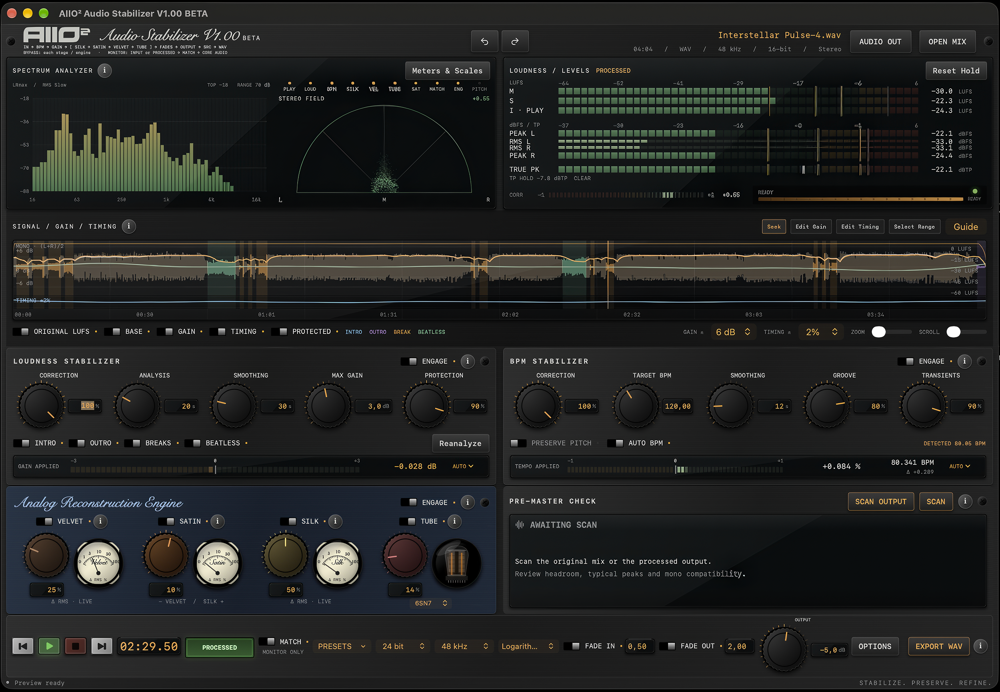

<div align="center">

# AIIO² Audio Stabilizer
### AS-1 | Dedicated Pre-Master Audio Processor

**STABILIZE. PRESERVE. REFINE.**


*Hardware-inspired software. Designed for sound.*


**Less Digital. More Music.**

<br>

[](https://github.com/AIIO2/AIIO2-Audio-Stabilizer/releases/download/v1.01-beta/AIIO2-AS-1-V1.01-BETA.zip)

**V1.01 BETA · Build 10010 · macOS 14+ · Apple Silicon**

[User Manual (PDF)](https://github.com/AIIO2/AIIO2-Audio-Stabilizer/releases/download/v1.01-beta/AS-1-User-Manual.pdf) · [Installation](#installation) · [Release Notes](../../releases/tag/v1.01-beta) · [SHA-256 Checksums](https://github.com/AIIO2/AIIO2-Audio-Stabilizer/releases/download/v1.01-beta/SHA256SUMS.txt)

[License](LICENSE.txt) · [Bug Reports](../../issues) · [Community](../../discussions) · [Contact](mailto:RonnyK.1980@icloud.com)

<br>

</div>

---

## Overview

AIIO² Audio Stabilizer (AS-1) is a dedicated standalone
pre-master audio processor for macOS, combining
intelligent loudness stabilization, adaptive tempo
correction, advanced signal analysis and a proprietary
analog-inspired sound processing architecture.

Its purpose is not to master your music.

**Its purpose is to give your mastering chain a better
starting point.**

Audio Stabilizer focuses on preserving musical dynamics,
improving structural consistency and refining unwanted
digital sound characteristics before the final
mastering stage.

All audio processing takes place locally on your Mac.

---

## Latest Update — Build 10010

**V1.01 Public Beta · Playback Engine Update · November 27, 2026**

This update focuses on real-time playback stability,
monitoring responsiveness and improved flexibility
across different Apple Silicon hardware configurations.

Developed in response to feedback from early beta
testers.

### Audio Options

- Adjustable hardware output buffer size.
- Adjustable ARE processing buffer.
- Persistent audio buffer settings.
- Estimated playback latency display.
- Buffer underrun counter.

### Optimized Playback Engine

- Buffered playback startup.
- Increased audio processing reserve.
- Higher background processing priority.
- Optimized real-time ARE processing pipeline.

### Direct A/B Monitoring

- Immediate PROCESSED / UNPROCESSED switching without restarting playback.
- Musical position mapping during BPM correction.
- Original audio remains unchanged.
- Direct comparison at corresponding musical positions.

### ARE Processing Controls

- Improved responsiveness when adjusting ARE parameters.
- Dynamic updates of precomputed audio blocks.
- Short sample-aligned transitions during parameter adjustments.
- Immediate ARE bypass switching.
- MATCH measurement reset when switching ARE states.

### Interface

- ENGAGE renamed to BYPASS.
- AUDIO OUT renamed to AUDIO OPTIONS.
- Orange AUDIO OPTIONS and OPEN MIX buttons.
- Estimated ARE switching delay indication.

### Sound Quality

The proprietary Analog Reconstruction Engine and offline
export implementation remain unchanged.

SILK, SATIN, VELVET and THERMIONIC retain their original
processing algorithms and sonic character.

Stationary audio comparison tests produced byte-identical
results in the tested scenarios.

Improved playback stability on earlier Apple Silicon
hardware remains subject to real-world testing.

[Read the complete release notes](../../releases/tag/v1.01-beta)

---

## Previous Update — Build 10006

The initial V1.01 update introduced:

- Improved loudness stabilization with smoother transitions across beatless passages.
- Improved handling of predominantly beatless music.
- Smooth automatic gain protection at recognized intro and outro boundaries.
- BPM detection confidence indicator: LOW / MEDIUM / HIGH.
- Automatic initialization of target BPM from the detected track tempo.
- Improved manual gain and timing keyframe editing.
- Smoother transitions around manually removed correction ranges.
- Streamlined Pre-Master Check workflow.
- Visible factory and user preset names.
- AIIO² SIGNATURE as the initial preset for new installations.
- Updated User Manual and in-app guidance.

Existing valid user settings are retained when upgrading.

---

## Development Philosophy

The development of Audio Stabilizer began with a
practical problem encountered while producing music
with modern generative audio systems.

Even musically impressive productions can contain
inconsistent loudness, subtle tempo drift, unstable
spectral textures and unwanted digital harshness.

Conventional mastering processors are not necessarily
designed to address these problems at their source.

Audio Stabilizer was developed to approach them
differently.

Rather than forcing audio into a predefined loudness
target or applying conventional frequency correction,
its processing architecture is designed to work with
the existing musical material.

Although originally inspired by the challenges of
AI-generated music, Audio Stabilizer is designed for
both conventional and AI-assisted music production.

---

## The Analog Reconstruction Engine
### Beyond Equalization. Beyond Spectral Denoising.

The proprietary Analog Reconstruction Engine (ARE)
is the sonic core of Audio Stabilizer.

It represents an independently developed processing
architecture that approaches digital harshness,
spectral instability and tonal refinement from a
different perspective.

Conventional equalization primarily modifies the
amplitude of selected frequency regions.

Many audio enhancement and restoration tools, on
the other hand, rely on spectral denoising techniques
that identify and attenuate unwanted spectral components.

While effective for their intended purposes, these
approaches can also affect desirable musical information,
particularly when unwanted digital textures are closely
intertwined with the original sound.

**The ARE approaches this challenge differently.**

Rather than relying solely on frequency correction
or spectral subtraction, it combines adaptive spectral
refinement, nonlinear signal shaping, harmonic enrichment
and analog-inspired processing.

Its algorithms respond to the structure, energy and
dynamic behavior of the musical signal itself.

The objective is not simply to remove unwanted sound,
but to refine its digital character while preserving
as much musical substance, texture and detail as possible.

Four complementary processors form its sonic
architecture.

### VELVET

**Weight. Foundation. Substance.**

An analog-inspired nonlinear processing stage designed
to enhance the perceived body and coherence of the
low-frequency material.

- Nonlinear line-stage processing
- Push-pull bass architecture
- Subtle harmonic enrichment
- Enhancement of existing low-frequency content
- No synthetic sub-bass generation

VELVET is designed to add substance to the existing
signal rather than simply boost a predefined
frequency range.

### SATIN

**Texture. Balance. Character.**

A bipolar midrange refinement processor providing
continuous control between two complementary sonic
characteristics.

- Negative values: warmer, VELVET-inspired character
- Positive values: smoother, SILK-inspired character
- Neutral position: bypass
- Signal-dependent processing rather than conventional EQ

SATIN allows the user to refine the character of
the midrange without relying on conventional
equalization curves alone.

### SILK

**Clarity without unnecessary harshness.**

SILK uses adaptive, multi-stage spectral processing
designed to address unwanted digital roughness,
unstable spectral textures and excessive harshness.

Its approach differs from conventional noise-profile-based
spectral denoising.

Rather than treating unwanted spectral components solely
as noise to be removed, SILK evaluates the behavior
and structure of the musical signal itself.

- Adaptive multi-stage spectral refinement
- Signal-dependent processing
- Transient and harmonic protection
- Reduction of perceived digital harshness
- Preservation of musical character
- No conventional noise profile required

This approach is particularly relevant when unwanted
digital textures are embedded within the musical
material itself rather than existing as a clearly
separable noise source.

By reducing perceived spectral roughness before mastering,
SILK may reduce the need for aggressive corrective EQ,
helping retain high-frequency detail while achieving a
smoother and more pleasant top end.

SILK is not intended to reconstruct missing original
audio information or replace specialized audio
restoration tools.

### THERMIONIC / TUBE

**Harmonics. Depth. Analog-inspired character.**

A dynamic nonlinear processing architecture inspired
by the sonic characteristics of classic vacuum tube
circuits.

Four distinct tube-inspired profiles are available:

| Profile | Description |
|---|---|
| 12AU7 | Original tube-inspired character profile |
| 12AX7 | Original tube-inspired character profile |
| 6SN7 | Original tube-inspired character profile |
| 300B | Original tube-inspired character profile |

The processing incorporates dynamic saturation,
shared stereo energy behavior, sag-inspired response
and adaptive mid/side characteristics.

These profiles are original digital interpretations,
not measured reproductions of specific hardware units.

### Processing Architecture

The ARE incorporates:

- Adaptive spectral processing
- Nonlinear harmonic processing
- Residual-based processing architecture
- Signal-dependent processing
- Transient and harmonic protection
- 8x oversampling in designated nonlinear stages
- Double-precision calculations in relevant DSP stages
- Independent module activation
- Global ARE bypass

The ARE is neither a conventional equalizer nor a
traditional spectral denoiser.

It represents a dedicated approach to musical
signal refinement.

Specialized spectral denoising and restoration remain
valuable when dealing with severe artifacts, persistent
noise or heavily damaged recordings.

Where necessary, these processes can complement
Audio Stabilizer within the wider production and
mastering workflow.

**The goal is not simply to remove unwanted sound.**

**The goal is to preserve the music while refining
its digital character.**

---

## Loudness Stabilizer

Unlike conventional loudness normalization or dynamic
range compression, the Loudness Stabilizer is designed
to reduce unwanted long-term level inconsistencies
between comparable musical sections.

It does not force the entire track toward a fixed
LUFS target.

Dedicated arrangement protection helps preserve
intentional musical contrasts, including:

- Introductions
- Outros
- Breaks
- Beatless sections

V1.01 introduces smoother transitions between corrected
and protected sections.

Short beatless passages can smoothly bridge surrounding
gain corrections, while longer passages can gradually
return toward neutral gain before correction resumes.

Loudness stabilization remains available for predominantly
beatless material.

Recognized intro and outro boundaries receive smoothly
weighted automatic gain protection when the corresponding
protection options are enabled.

Adjustable analysis, correction, smoothing and gain
limits allow the stabilization behavior to be adapted
to the individual production.

Musical dynamics remain an essential part of the
production rather than an obstacle to be eliminated.

---

## BPM Stabilizer

Designed to address subtle tempo drift and unwanted
timing inconsistencies while retaining musical movement.

- Automatic tempo analysis
- BPM detection confidence: LOW / MEDIUM / HIGH
- Automatic or manually selected target BPM
- Automatic target initialization from detected track tempo
- Manual target adjustment within ±8% of the detected tempo
- Adjustable correction strength
- Tempo smoothing
- Groove preservation controls
- Transient protection
- Optional pitch preservation
- Manual timing curve editing

Manual target adjustment is available when AUTO BPM is
disabled and tempo detection is sufficiently reliable.

When tempo detection is unreliable, automatic tempo
correction is paused and AUTO BPM is disabled.

After loading another track with reliable tempo detection,
AUTO BPM can be manually re-enabled.

The BPM Stabilizer is not intended to quantize every
musical event to a rigid timing grid.

Its purpose is to improve long-term tempo consistency
while respecting the musical characteristics of
the performance.

Tempo and arrangement detection remain heuristic.

---

## Precision Audio Analysis

Audio Stabilizer provides an integrated environment
for evaluating both the original and processed signal.

- Real-time spectrum analyzer
- Configurable spectrum resolution and display scales
- Stereo field visualization
- Stereo correlation analysis
- Momentary and short-term loudness
- Playback-integrated loudness
- True-peak metering
- Peak and RMS metering
- Interactive signal visualization
- Editable gain and timing curves
- Level-matched A/B monitoring

Monitoring tools allow processing decisions to be
evaluated both visually and by listening.

The MATCH function is intended for monitoring only
and does not affect the exported audio.

### Manual Curve Editing

Gain and timing corrections can be refined manually
using editable keyframes.

V1.01 introduces:

- Neutral keyframe insertion based on the existing manual curve.
- Relative keyframe dragging.
- Preservation of existing correction-removal ranges when inserting new keyframes.
- Smooth transitions around removed gain and timing correction ranges.

Removing a correction range affects the correction
curve, not the underlying audio content.

---

## Audio Options & Playback Engine

Introduced in Build 10010.

AS-1 is a dedicated pre-master audio processor,
not a live performance tool.

Its playback architecture prioritizes processing
quality and stable monitoring over ultra-low latency.

A dedicated AUDIO OPTIONS panel allows the playback
environment to be adapted to different hardware
configurations and processing workloads.

### Configurable Audio Settings

| Setting | Function |
|---|---|
| Output Device | Select the audio output device |
| Output Buffer | Configure the hardware output buffer in samples |
| Processing Buffer | Configure additional ARE processing reserve |
| Playback Latency | Estimated overall playback delay |
| Buffer Underruns | Counter for detected buffer underruns |

Available hardware output buffer sizes depend on the
selected audio device.

The ARE processing buffer provides three settings:

- Small
- Medium
- Large

### Default Configuration

| Setting | Default |
|---|---|
| Output Buffer | 1024 samples |
| Processing Buffer | Medium |

Audio buffer preferences are stored locally and
retained between application sessions.

Increasing the buffer sizes may improve playback
stability at the expense of additional monitoring latency.

### Optimized Real-Time Processing

The updated playback architecture incorporates:

- Buffered playback startup
- Increased processing reserve
- Higher background processing priority
- Dynamic updates of precomputed audio blocks
- Short sample-aligned transitions during parameter changes

These improvements are designed to reduce playback
interruptions and improve parameter responsiveness
without altering the proprietary ARE algorithms.

### Immediate A/B Monitoring

PROCESSED / UNPROCESSED switching now takes place
without restarting playback.

Musical positions are mapped between the original
and processed signal, including when BPM stabilization
is active.

The original audio remains unchanged.

To enable immediate switching, the ARE continues
processing in the background during UNPROCESSED
monitoring.

Selecting UNPROCESSED is therefore not equivalent
to disabling the ARE processing workload.

The main ARE BYPASS control bypasses the four
character-processing modules.

### Playback Troubleshooting

If you experience clicks, stuttering or interrupted
playback:

1. Open AUDIO OPTIONS.
2. Increase the available hardware output buffer size.
3. Select a larger ARE processing buffer.
4. Monitor the buffer underrun counter.
5. Check whether the issue occurs with specific ARE modules.
6. Compare live playback with an exported WAV file.

Real-time processing performance may vary depending
on processor generation, audio device, sample rate,
active modules and available system resources.

Improved playback stability on earlier Apple Silicon
hardware remains subject to real-world testing.

---

## Pre-Master Check

A dedicated offline analysis system evaluates the
original mix or processed output before export.

The Pre-Master Check focuses on:

- Available headroom
- True-peak levels
- Typical signal peaks
- Potential overload conditions
- Mono compatibility
- Output gain recommendations

The processed output can be evaluated with the
selected export sample rate taken into account.

The integrated output gain recommendation targets
a maximum true-peak level of -6 dBTP, providing a
consistent starting point for subsequent mastering.

V1.01 introduces a streamlined APPLY function.

Applying the recommended output gain updates existing
peak readings using the gain difference, without
requiring a complete new render and scan.

Existing mono compatibility findings are preserved.

Changes to processing settings, correction curves or
the selected export sample rate invalidate previous
output scan results.

APPLY is a calculated measurement update, not an
independent new measurement. A fresh scan may produce
different typical-peak readings for very quiet material.

The objective is to identify technical conditions
that may affect subsequent mastering.

A successful check is not a guarantee of mastering
quality or universal playback compatibility.

---

## User Interface



*Interface shown from an earlier public beta. Some controls, indicators and button colors have changed in subsequent builds.*

A hardware-inspired rack interface brings all major
processing and analysis modules together in a single
workspace.

- Dedicated processing modules
- Independent module activation
- Interactive signal and correction curves
- Analog-inspired meters and controls
- Factory and user settings presets
- Visible preset names
- Integrated playback and export controls
- Dedicated AUDIO OPTIONS panel

No plugin chains. No unnecessary windows.
No complex routing.

### AIIO² SIGNATURE

New installations begin with the AIIO² SIGNATURE
preset, providing a recommended starting point for
exploring the processing architecture.

Existing valid settings are retained when upgrading
from a previous version.

All factory preset values remain unchanged in V1.01.

The displayed preset name identifies the last selected
or initial preset and does not guarantee that all
current parameters match its original values.

---

## Audio Export

| Feature | Specification |
|---|---|
| Output format | Stereo WAV |
| Integer PCM | 16-bit / 24-bit |
| Floating-point | 32-bit float |
| Sample rate | Original or selectable |
| Selectable sample rates | 44.1–192 kHz |
| Dithering | Optional TPDF for integer PCM |
| Output gain | Adjustable |
| Fade-in / Fade-out | Adjustable |
| Fade characteristics | Multiple selectable curves |

The exported audio is intended for further mastering
or other subsequent production stages.

The offline export implementation remains unchanged
in Build 10010.

---

## Built for Pre-Mastering

Audio Stabilizer deliberately avoids conventional
final-stage mastering processors.

It does not contain:

- A conventional mastering equalizer
- A multiband mastering compressor
- A loudness maximizer
- A brickwall limiter

These creative and technical decisions remain with
the mastering engineer.

Audio Stabilizer is not a mastering suite.

It is designed to provide a more consistent, refined
and musically coherent signal before the creative
and technical decisions of mastering begin.

Conventional EQ, compression, specialized restoration
and limiting remain valuable tools in the subsequent
mastering workflow.

The objective is to prepare a smoother, more open and
more pleasant signal that may require less aggressive
corrective processing during mastering.

**Prepare the signal. Preserve the music.
Let mastering do the rest.**

---

## System Requirements

| Requirement | Specification |
|---|---|
| Operating system | macOS 14 or later |
| Processor | Apple Silicon |
| Architecture | Native ARM64 |
| Application type | Standalone |
| Minimum display workspace | 1440 × 960 logical points |
| Audio processing | Stereo |
| Export format | WAV |
| Internet connection for audio processing | Not required |
| Account or activation | Not required |

Intel Macs, Windows and Linux are not currently
supported.

The rack interface requires sufficient logical screen
space. Depending on your Mac and display, an adjusted
display scaling setting or an external monitor may
be necessary.

This is particularly relevant for smaller MacBook
displays.

Compatibility across all supported macOS versions and
hardware configurations has not been independently
established.

---

## Free Public Beta
### V1.01 PUBLIC BETA — Build 10010

AIIO² Audio Stabilizer is currently provided free of
charge under its proprietary beta license.

- Free for personal music production
- Free for professional and commercial music production
- No subscription
- No account required
- No online activation
- No scheduled beta expiration
- Proprietary, closed-source software
- Local audio processing
- Comprehensive English User Manual included

This is an early public beta. Unexpected behavior
and compatibility limitations may occur.

Please retain your original audio files and verify
processed exports before using them in production.

Future versions may be offered under different
licensing terms.

[Read the Public Beta License](LICENSE.txt)

---

## Download

<div align="center">

[](https://github.com/AIIO2/AIIO2-Audio-Stabilizer/releases/download/v1.01-beta/AIIO2-AS-1-V1.01-BETA.zip)

**V1.01 PUBLIC BETA**

macOS 14+ · Apple Silicon · Build 10010

[User Manual (PDF)](https://github.com/AIIO2/AIIO2-Audio-Stabilizer/releases/download/v1.01-beta/AS-1-User-Manual.pdf) · [SHA-256 Checksums](https://github.com/AIIO2/AIIO2-Audio-Stabilizer/releases/download/v1.01-beta/SHA256SUMS.txt) · [All Releases](../../releases)

</div>

### Release Package Contents

- AS-1.app
- AS-1-User-Manual.pdf
- README.txt
- LICENSE.txt
- PRIVACY-NOTICE.txt
- RELEASE-NOTES.txt
- THIRD-PARTY-NOTICES.txt

---

## Installation

1. Download the official ZIP package from this repository.
2. Verify the SHA-256 checksum.
3. Extract the downloaded ZIP archive.
4. Move AS-1.app to your Applications folder.
5. Launch AS-1.

No additional installation software, account
registration or online activation is required.

### Updating from an Earlier Version or Build

1. Quit Audio Stabilizer.
2. Download and extract the current release package.
3. Replace the previous AS-1.app in your Applications folder.
4. Launch the updated application.
5. Review the new AUDIO OPTIONS settings.

Valid previously saved processing settings are retained.

### Important — First Launch on macOS

The Public Beta is ad-hoc signed but is not currently
Developer ID signed or notarized by Apple.

When launching AS-1 for the first time, macOS Gatekeeper
may display a message stating that Apple could not verify
the application.

This is expected for this non-notarized release and is
not, by itself, a specific malware detection. However,
it also does not establish that the application is safe.

Only proceed if you have obtained the application from
this official repository and independently trust its
source.

If you decide to open the application:

1. Click **Done** to dismiss the initial warning.
2. Open **System Settings**.
3. Select **Privacy & Security**.
4. Scroll down to the **Security** section.
5. Locate the message concerning AS-1.
6. Click **Open Anyway**.
7. Authenticate if requested and confirm your decision.

For reference, the corresponding German macOS settings
are **Datenschutz & Sicherheit → Dennoch öffnen**.

macOS creates an exception for the application.
Global security protections remain enabled.

[Apple's official instructions for opening applications safely](https://support.apple.com/en-us/102445)

> [!IMPORTANT]
> Never globally disable Gatekeeper or other macOS
> security protections. Do not override a specific
> malware detection or a warning that the application
> is damaged.

### Download Integrity Verification

SHA-256 checksums are provided for the ZIP package
and the separately downloadable User Manual.

If both files and SHA256SUMS.txt are located in your
Downloads folder, open Terminal and enter:

```bash
cd ~/Downloads
shasum -a 256 -c SHA256SUMS.txt
```

Both files should return OK.

Official V1.01 Build 10010 SHA-256 checksums:

**AIIO2-AS-1-V1.01-BETA.zip**

```
42c3ec5d59c53aa0b0d0128329f96f0ed176430eacf77862a828801bd8d768b0
```

**AS-1-User-Manual.pdf**

```
e4c5aa9fe68657b7d167a86d34947a3a06328ffe013325958751fddb17639411
```

A matching checksum verifies consistency with the
published release files. It does not independently
establish software safety.

---

## Documentation

The comprehensive English User Manual covers:

- Installation and initial setup
- Complete interface overview
- Individual processing modules
- Analog Reconstruction Engine
- Signal processing principles
- Audio analysis and metering
- Gain and timing curve editing
- BPM detection and target controls
- Pre-Master Check
- Audio export
- Technical specifications
- Recommended production workflows

The manual describes V1.01 BETA, Build 10006.

The proprietary ARE and offline processing descriptions
remain applicable to Build 10010.

Some playback controls, switching behavior and interface
descriptions differ in the current build.

Please refer to the current release notes and the
Audio Options section of this README for information
about the updated playback engine.

The User Manual is included in the official release
package and is also available as a separate PDF download.

<div align="center">

[](https://github.com/AIIO2/AIIO2-Audio-Stabilizer/releases/download/v1.01-beta/AS-1-User-Manual.pdf)

</div>

---

## Quality Assurance

### Current Build — 10010

- Targeted switching tests passed.
- Targeted buffering tests passed.
- Concurrent-access tests passed.
- Stationary audio comparison tests produced byte-identical results in the tested scenarios.
- ARE algorithms and offline export implementation remain unchanged.
- Application signature verified.
- Release archive integrity verified.
- Signature verification after archive extraction passed.
- Local launch and functional testing completed on Apple M4 hardware.

Playback stability on earlier Apple Silicon hardware
remains subject to real-world testing.

### Previous Build — 10006

- 250 automated checks passed.
- All 41 new targeted tests passed.
- No new regressions identified in the executed comparison tests.
- No new external software dependencies identified in the Build 10006 audit.

Four legacy test assertions remained unsuccessful in
both Build 10001 and Build 10006.

Two concern normalization of a legacy monitor setting.
Two compare different processing stages and do not
validate the actual live audio output.

A separate complete third-party dependency and rights
audit for Build 10010 has not been performed.

Complete physical audio-device testing and compatibility
verification across all target systems remain outstanding.

---

## Known Limitations

- Apple Silicon only.
- Standalone application, not an AU/VST plugin.
- Arrangement and tempo detection remain heuristic.
- Pitch preservation may introduce artifacts.
- Live preview and offline export are not guaranteed to be sample-identical.
- Larger audio buffers increase monitoring latency.
- ARE processing remains active during UNPROCESSED monitoring.
- Real-time playback performance may vary across Apple Silicon generations.
- The displayed preset name does not guarantee that all current settings match the original preset.
- AUTO BPM may require manual reactivation after unreliable tempo detection.
- APPLY updates existing measurements rather than performing an independent new scan.
- Severe audio artifacts may require dedicated restoration tools.
- Metering is not independently standards-certified.
- No automatic mastering EQ or brickwall limiter.
- The included User Manual describes Build 10006.
- Full compatibility verification across all supported systems remains outstanding.

---

## Privacy

Audio processing is performed locally.

The application is designed to operate without:

- Cloud-based audio processing
- User registration
- Online activation
- Subscription requirements

Audio files do not need to be uploaded to an
external service for processing.

Processing settings, preset names, audio buffer settings
and application preferences may be stored locally.

The development audit identified no built-in telemetry,
analytics or audio upload service. Runtime network
behavior has not been independently verified.

Further information is provided in the Privacy Notice
included in the release package.

---

## Feedback & Community

Audio Stabilizer is an independently developed
audio software project.

Constructive feedback, listening experiences,
compatibility reports and bug reports are welcome.

The Public Beta is an opportunity to evaluate the
software across different musical styles, production
workflows and listening environments.

Special thanks to the early beta testers whose
feedback helped improve the playback engine.

### Bug Reports

Please use [GitHub Issues](../../issues) to report
technical problems.

When reporting an issue, please include:

- Application version and build number
- macOS version
- Mac model or processor
- Available RAM
- Relevant processing settings
- A description of the unexpected behavior
- Steps to reproduce the issue, if possible

For playback-related issues, please also include:

- Audio output device
- Source audio sample rate
- Output buffer setting
- Processing buffer setting
- Active ARE modules
- Buffer underrun count
- Whether the issue affects live playback, offline export or both

Please do not publicly upload copyrighted or
confidential audio material without permission.

### Community Discussions

Use [GitHub Discussions](../../discussions) to share:

- Listening experiences
- Preferred ARE settings
- Production workflows
- Feature suggestions
- General questions
- Constructive feedback

---

## About This Repository

This is the official distribution, documentation
and support repository for AIIO² Audio Stabilizer.

Audio Stabilizer is proprietary, closed-source
software.

The application source code and proprietary DSP
algorithms are not publicly distributed.

This repository provides official application releases,
product documentation, release notes, bug reporting
and community support.

The automatically generated source archives provided
by GitHub contain only the public repository files,
not the application source code.

The free Public Beta does not imply that future
versions will necessarily be distributed free of charge.

[Public Beta License](LICENSE.txt)

---

## Developer & Contact

**Ronny Künniger**

Independent audio software development

Germany

Contact: [RonnyK.1980@icloud.com](mailto:RonnyK.1980@icloud.com)

---

<div align="center">

**AIIO² AUDIO LAB**

**STABILIZE. PRESERVE. REFINE.**

*Less Digital. More Music.*

Copyright © 2026 Ronny Künniger.

</div>
