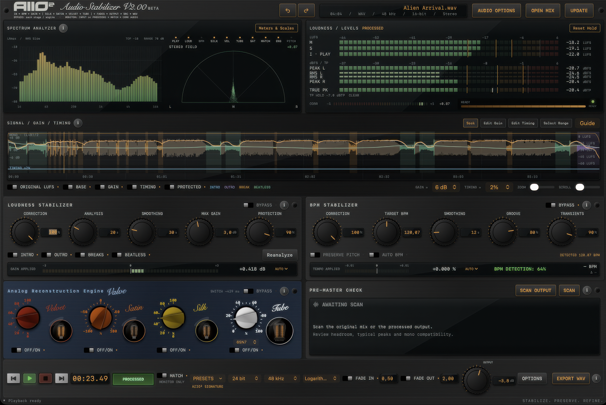

<div align="center">

# AIIO² Audio Stabilizer

### AS-2 | Dedicated Pre-Master Audio Processor

**STABILIZE. PRESERVE. REFINE.**

*Less Digital. More Music.*


<br>

[](https://github.com/AIIO2/AIIO2-Audio-Stabilizer/releases/download/v2.00-beta-build10019/AS-2-V2.00-BETA-Build10019.zip)

**V2.00 BETA · Build 10019 · macOS 14+ · Apple Silicon**

[User Manual (PDF)](https://github.com/AIIO2/AIIO2-Audio-Stabilizer/releases/download/v2.00-beta-build10019/AS-2-User-Manual.pdf) · [Installation](#installation) · [Homebrew](#alternative-installation-via-homebrew) · [Release Notes](../../releases/tag/v2.00-beta-build10019)

[License](LICENSE.txt) · [Bug Reports](../../issues) · [Community](../../discussions) · [Contact](mailto:RonnyK.1980@icloud.com)

</div>

---

## Overview

AIIO² Audio Stabilizer (AS-2) is a dedicated standalone pre-master audio processor for macOS, combining intelligent loudness stabilization, adaptive tempo correction, comprehensive signal analysis and a proprietary analog-inspired sound processing architecture.

Originally developed to address the challenges of AI-generated music, AS-2 is equally intended for conventional and AI-assisted music production.

Its purpose is not to master your music.

**Its purpose is to give your mastering chain a better starting point.**

AS-2 focuses on preserving musical dynamics, improving structural consistency and gently refining unwanted digital sound characteristics.

All audio processing takes place locally on your Mac.

---

## Development Philosophy

Even musically impressive productions can contain inconsistent loudness, subtle tempo drift, unstable spectral textures and unpleasant digital harshness.

The development of Audio Stabilizer began with a practical question:

**What if we could make an existing mix sound a little better without fundamentally changing its musical identity?**

The objective is not to eliminate every artifact, filter out every imperfect component or reshape the music into something else.

Instead, AS-2 is designed to make the existing signal:

- More consistent.
- Slightly softer.
- More open.
- Less digitally harsh.
- More pleasant to listen to.
- Better prepared for subsequent mastering.

Rather than forcing audio into predefined loudness targets or relying exclusively on conventional frequency correction, its processing architecture responds to the musical material itself.

AS-2 deliberately avoids aggressive processing as its primary objective.

> [!IMPORTANT]
> AS-2 does not replace your mastering chain and is not intended to do so. Dedicated restoration, corrective EQ, compression, limiting and final loudness decisions remain part of the subsequent production and mastering workflow.

**Prepare the signal. Preserve the music. Let mastering do the rest.**

---

## Application Interface



*Actual AS-2 V2 application interface.*

A hardware-inspired rack interface brings all major processing, monitoring and analysis modules together in a single workspace.

- Interactive waveform and correction curves.
- Dedicated loudness and tempo stabilization modules.
- Four independent analog-inspired character processors.
- Animated processing activity indicators.
- Configurable spectrum analyzer and stereo field display.
- Comprehensive loudness and peak metering.
- Integrated Pre-Master Check.
- Factory and user presets.
- Dedicated audio configuration and playback diagnostics.
- Integrated software updates.

No plugin chains. No complex routing. One dedicated environment for pre-master preparation.

---

## The Analog Reconstruction Engine

### Beyond conventional frequency correction

The proprietary Analog Reconstruction Engine (ARE) is the sonic core of AS-2.

Conventional equalization primarily modifies the amplitude of selected frequency regions. Specialized spectral denoising identifies and attenuates unwanted spectral components.

Both are valuable tools. However, digital roughness and unwanted textures can be closely intertwined with desirable musical information.

The ARE approaches this challenge differently.

It combines adaptive spectral refinement, nonlinear signal shaping, harmonic enrichment and analog-inspired processing.

Its algorithms respond to the structure, energy and behavior of the musical signal itself.

The objective is not simply to remove unwanted sound, but to refine its digital character while preserving musical substance, texture and detail.

Four complementary processors form its sonic architecture.

### VELVET

**Weight. Foundation. Substance.**

An analog-inspired nonlinear processing stage designed to enhance the perceived body and coherence of low-frequency material.

- Nonlinear line-stage processing.
- Balanced push-pull foundation architecture.
- Subtle harmonic enrichment.
- Enhancement of existing low-frequency content.
- Oversampled nonlinear processing.
- No synthetic sub-bass generation.

VELVET is designed to add substance to the existing signal rather than simply boost a predefined frequency range.

Its effect depends on the low-frequency content already present in the source.

### SATIN

**Texture. Balance. Character.**

A bipolar midrange refinement processor offering two complementary sonic directions.

- Negative values: warmer, VELVET-inspired nonlinear character.
- Positive values: smoother, SILK-inspired spectral refinement.
- Neutral center position.
- Independent module activation.
- Signal-dependent processing rather than conventional EQ.

The positive and negative directions represent different processing architectures, not conventional midrange boost and cut.

SATIN allows the user to refine the character of the middle register while retaining control over musical articulation and presence.

### SILK

**Clarity without unnecessary harshness.**

SILK uses adaptive, multi-stage spectral processing designed to address perceived digital roughness, metallic textures and excessive high-frequency harshness.

Its approach differs from conventional noise-profile-based spectral denoising.

Rather than relying on a predefined noise profile, SILK evaluates the local structure and behavior of the musical signal.

- Adaptive multi-stage spectral refinement.
- Signal-dependent processing.
- Transient and harmonic protection.
- Stereo-linked spectral treatment.
- Reduction of perceived digital harshness.
- No conventional noise profile required.

This approach is particularly relevant when unwanted digital textures are embedded within the musical material itself rather than existing as a clearly separable noise source.

SILK aims to achieve a smoother and more pleasant upper register without unnecessarily stripping the identity of percussion, harmonics or ambience.

SILK does not reconstruct missing audio information and cannot perfectly distinguish unwanted artifacts from musical detail.

### TUBE

**Harmonics. Depth. Analog-inspired character.**

A dynamic nonlinear processing architecture inspired by the sonic characteristics of classic vacuum tube circuits.

Four distinct listening signatures are available:

| Profile | Sonic character |
|---|---|
| 12AU7 | Restrained, intimate and softly rounded |
| 12AX7 | Forward, expressive and harmonically rich |
| 6SN7 | Silky, balanced and cohesive |
| 300B | Warm, flowing and gently luminous |

The processing incorporates dynamic saturation, shared stereo energy behavior, sag-inspired response and profile-dependent stereo presentation.

These profiles are original digital interpretations, not measured reproductions of specific physical hardware units.

### Processing Architecture

The ARE incorporates:

- Adaptive spectral processing.
- Nonlinear harmonic processing.
- Residual-based signal reconstruction.
- Signal-dependent processing.
- Transient and harmonic protection.
- Oversampling in designated nonlinear stages.
- Double-precision calculations in relevant DSP stages.
- Independent module activation.
- Global ARE bypass.

The ARE is neither a conventional equalizer nor a traditional spectral denoiser.

Specialized spectral denoising and restoration remain valuable when dealing with severe artifacts, persistent noise or heavily damaged recordings.

**The goal is to preserve the music while refining its digital character.**

---

## Loudness Stabilizer

Unlike conventional loudness normalization or dynamic range compression, the Loudness Stabilizer is designed to reduce unwanted long-term level inconsistencies between comparable musical sections.

It does not force the entire track toward a fixed LUFS target.

Dedicated arrangement protection helps preserve intentional musical contrasts, including:

- Introductions.
- Outros.
- Breaks.
- Beatless sections.

Short protected passages can smoothly bridge surrounding gain corrections, while longer passages can gradually return toward neutral gain before correction resumes.

Loudness stabilization remains available for predominantly beatless material.

Adjustable analysis, correction, smoothing, protection and gain limits allow the stabilization behavior to be adapted to individual productions.

Musical dynamics remain an essential part of the production rather than an obstacle to be eliminated.

---

## BPM Stabilizer

Designed to address subtle tempo drift and unwanted timing inconsistencies while retaining musical movement.

- Automatic tempo analysis.
- BPM detection coverage displayed as a percentage.
- Automatic or manually selected target BPM.
- Automatic target initialization from detected track tempo.
- Target adjustment within ±8% of the detected tempo.
- Adjustable correction strength.
- Tempo smoothing.
- Groove-related smoothing controls.
- Transient handling.
- Optional pitch preservation.
- Manual timing curve editing.

BPM DETECTION indicates the estimated proportion of the track with usable local tempo estimates.

| Detection coverage | Status |
|---|---|
| Below 40% | Insufficient coverage; automatic correction paused |
| 40% to below 60% | Partial coverage; review carefully |
| 60–100% | Greater coverage; musical verification still recommended |

The percentage does not represent a probability that the detected BPM is correct.

The BPM Stabilizer is not intended to quantize every musical event to a rigid timing grid.

Its purpose is to improve long-term tempo consistency while respecting the musical characteristics of the performance.

Tempo and arrangement detection remain heuristic.

---

## Audio Analysis & Monitoring

AS-2 provides an integrated environment for evaluating both the original and processed signal.

- Real-time spectrum analyzer.
- Configurable spectrum bands and display scales.
- Stereo field visualization.
- Stereo correlation analysis.
- Momentary and short-term LUFS.
- Playback-integrated loudness.
- True-peak metering and peak hold.
- Peak and RMS metering.
- Interactive signal visualization.
- Editable gain and timing curves.
- Configurable meter visibility and response.
- Level-matched A/B monitoring.

Monitoring tools allow processing decisions to be evaluated both visually and by listening.

### Manual Curve Editing

Gain and timing corrections can be refined manually using editable keyframes.

- Neutral keyframe insertion.
- Relative keyframe adjustment.
- Numeric editing.
- Add at Playhead.
- Independent gain and timing correction masks.
- Smooth transitions around removed correction ranges.
- Undo and Redo.

Removing a correction range affects the correction curve, not the underlying audio content.

### Direct A/B Monitoring

PROCESSED and UNPROCESSED monitoring allows comparison at corresponding musical positions without restarting Core Audio.

The original signal remains unchanged.

The processed signal follows the tempo correction map, while the original plays at its native rate.

### MATCH

The MATCH function compensates perceived loudness differences during monitoring.

It also compensates the fixed final OUTPUT gain offset, including changes made through Pre-Master Check APPLY.

This allows processing decisions to be evaluated without being unnecessarily influenced by output gain differences.

**MATCH affects monitoring only. It never changes the exported WAV.**

---

## Streaming Audio Architecture

AS-2 introduces a fundamentally redesigned internal audio processing architecture.

Rather than repeatedly recalculating extensive portions of the track, AS-2 uses persistent, block-based streaming DSP.

Loudness and tempo correction curves are prepared in advance. The audio signal is then processed continuously through the active processing stages.

The architecture incorporates:

- Persistent DSP processing states.
- Prepared loudness and tempo correction maps.
- Bounded processing look-ahead.
- Reusable spectral processing resources.
- Persistent filter and oversampling histories.
- Shared processing architecture for playback, export and output scanning.

The redesigned architecture is intended to improve processing efficiency and responsiveness while preserving the established ARE sound character.

### Audio Options

| Setting | Function |
|---|---|
| Output Device | Select the Core Audio output |
| Output Buffer | Configure the hardware output buffer |
| Processing Buffer | Small, Medium or Large processing reserve |
| Estimated Latency | Estimated overall playback delay |
| Buffer Underruns | Counter for missing prepared audio samples |
| Playback Diagnostics | Save local diagnostic information |

Larger buffers can improve resistance to temporary scheduling interruptions at the expense of additional monitoring latency.

Buffer settings do not reduce exported audio quality.

AS-2 prioritizes audio preparation and stable monitoring over ultra-low-latency live performance.

---

## Pre-Master Check

A dedicated analysis system evaluates the original mix or processed output before export.

The Pre-Master Check focuses on:

- Available headroom.
- Maximum estimated true-peak level.
- Typical signal peaks.
- Potential overload conditions.
- Mono compatibility.
- Output gain recommendations.

Processed output analysis includes the selected export sample rate.

The integrated output gain recommendation targets a maximum estimated true-peak level of **−6 dBTP**, providing a consistent preparation target for subsequent mastering.

APPLY adjusts the absolute final OUTPUT gain and updates the existing peak measurements accordingly.

It is not a limiter or an independent new scan.

### Recommended Final Workflow

1. Complete all stabilization and ARE processing.
2. Finish fades and select the export sample rate.
3. Select SCAN OUTPUT.
4. Run SCAN and review the findings.
5. Press APPLY when appropriate.
6. Export WAV.

**SCAN OUTPUT → APPLY → EXPORT**

> [!IMPORTANT]
> Perform the final output scan after all processing and export settings have been finalized. MATCH compensates final output gain changes during monitoring, so perceived playback loudness is not a reliable indicator of exported headroom.

Changes to relevant processing or export settings require a fresh output scan.

The −6 dBTP preparation target is not a final release loudness target or a universal mastering requirement.

---

## Audio Export

| Feature | Specification |
|---|---|
| Output format | Stereo WAV |
| Integer PCM | 16-bit / 24-bit |
| Floating-point | 32-bit float |
| Sample rate | Original or selectable |
| Selectable sample rates | 44.1–192 kHz |
| Dithering | Optional TPDF for integer PCM |
| Output gain | −24 to +12 dB |
| Fade-in / Fade-out | Adjustable |
| Fade characteristics | Multiple selectable curves |
| Metadata | Optional clean tags |
| Export destination | User-selectable |

The original source file is never overwritten.

OUTPUT resets to 0 dB after each successful new audio import.

The exported audio is intended for further mastering or other subsequent production stages.

---

## Production Workflow

A typical AI-assisted music production workflow:

**Generated stereo mix → AS-2 → Pre-master WAV → Mastering chain**

AS-2 can also be used before stem separation if the complete stereo mix exhibits unwanted loudness or tempo drift.

For conventional productions with stable timing and dynamics, the stabilizers can be bypassed and the ARE used independently.

AS-2 does not include:

- A conventional mastering equalizer.
- A multiband mastering compressor.
- A loudness maximizer.
- A brickwall limiter.
- Stem separation.
- Comprehensive audio restoration.

These remain separate creative and technical decisions within the wider production workflow.

---

## System Requirements

| Requirement | Specification |
|---|---|
| Operating system | macOS 14 or later |
| Processor | Apple Silicon |
| Architecture | Native ARM64 |
| Application type | Standalone |
| Designed display workspace | 1440 × 960 logical points |
| Input | Stereo audio |
| Supported source rates | 8–384 kHz |
| Supported input includes | WAV, AIFF, FLAC |
| Export format | Stereo WAV |
| Internet for audio processing | Not required |
| Account or activation | Not required |

Intel Macs, Windows and Linux are not currently supported.

Display scaling or an external monitor may be necessary on smaller MacBook displays.

### Apple Silicon Compatibility

AS-2 is designed for native Apple Silicon operation.

On the first AS-2 startup on M1-family Macs, the application initializes the output buffer to 1024 samples and the processing buffer to Large.

Subsequent user preferences are retained.

**Real-world performance validation on M1-family Macs is still pending.**

Playback performance may vary with processor generation, sample rate, active processing modules, audio device and available system resources.

No universal minimum RAM requirement has been validated.

---

## Free Public Beta

### AS-2 V2.00 BETA — Build 10019

AIIO² Audio Stabilizer is currently provided free of charge under its proprietary beta license.

- Free for personal music production.
- Free for professional and commercial music production.
- No subscription.
- No account required.
- No online activation.
- No scheduled beta expiration.
- Proprietary, closed-source software.
- Local audio processing.

This is public beta software. Unexpected behavior and compatibility limitations may occur.

Retain your original audio files and verify processed exports before using them in production.

Future versions may be offered under different licensing terms.

[Read the Public Beta License](LICENSE.txt)

---

## Download

<div align="center">

[](https://github.com/AIIO2/AIIO2-Audio-Stabilizer/releases/download/v2.00-beta-build10019/AS-2-V2.00-BETA-Build10019.zip)

**V2.00 PUBLIC BETA**

macOS 14+ · Apple Silicon · Build 10019

[User Manual (PDF)](https://github.com/AIIO2/AIIO2-Audio-Stabilizer/releases/download/v2.00-beta-build10019/AS-2-User-Manual.pdf) · [All Releases](../../releases)

</div>

The release ZIP contains AS-2.app.

The User Manual is available as a separate PDF download.

---

## Installation

1. Download the official ZIP package from this repository.
2. Extract the downloaded ZIP archive.
3. Move AS-2.app to your Applications folder.
4. Launch AS-2.

No additional installation software, account registration or online activation is required.

### Updating from AS-1

AS-1 is now AS-2.

The application retains its existing bundle identifier so compatible preferences and presets can remain available.

1. Quit AS-1.
2. Back up your existing AS-1.app.
3. Remove the old application from the Applications folder.
4. Download and extract the current AS-2 release.
5. Move AS-2.app to Applications.
6. Launch AS-2 and review AUDIO OPTIONS.

Homebrew-managed installations should be updated through Homebrew instead.

### Important — First Launch on macOS

The Public Beta is ad hoc signed but is not currently Developer ID signed or notarized by Apple.

When launching AS-2 for the first time, macOS Gatekeeper may display a message stating that Apple could not verify the application.

This is not, by itself, a specific malware detection. However, it also does not establish that the application is safe.

Only proceed if you have obtained the application from the official repository and trust its source.

If you decide to open the application:

1. Click Done to dismiss the initial warning.
2. Open System Settings.
3. Select Privacy & Security.
4. Scroll down to the Security section.
5. Locate the message concerning AS-2.
6. Click Open Anyway, if available.
7. Authenticate if requested and confirm your decision.

For German macOS installations:

**Datenschutz & Sicherheit → Dennoch öffnen**

[Apple's official instructions for opening applications safely](https://support.apple.com/en-us/102445)

> [!IMPORTANT]
> Never globally disable Gatekeeper or other macOS security protections. Do not override a specific malware detection or a warning that the application is damaged.

---

## Alternative Installation via Homebrew

The existing official Homebrew Tap and cask identifier are retained for AS-2.

The historical cask name `as-1` remains unchanged to preserve compatibility with existing installations.

### Install

```bash
brew tap aiio2/as1
brew trust --cask aiio2/as1/as-1
brew install --cask aiio2/as1/as-1
```

The explicit trust command is required by Homebrew versions that enforce trust restrictions for third-party taps.

Only grant trust if you trust the official developer and repository.

### Update

```bash
brew update
brew upgrade --cask aiio2/as1/as-1
```

Quit the application before updating.

### Uninstall

```bash
brew uninstall --cask aiio2/as1/as-1
```

### Switching from a Manual Installation

Quit the application and move your existing AS-1.app or AS-2.app to a safe backup location before installing through Homebrew.

Homebrew verifies the SHA-256 checksum of the official release package during installation.

The standard macOS security requirements still apply.

[Official AIIO² Homebrew Tap](https://github.com/AIIO2/homebrew-as1)

**Homebrew is entirely optional.**

The standard ZIP download remains available and does not require Homebrew.

---

## Integrated Software Updates

AS-2 includes a native software update system.

- Automatic update checks at startup.
- Configurable automatic update preference.
- Manual update checks through UPDATE or Check for Updates.
- Native in-app ZIP downloads.
- Selectable download destination.
- Download progress indication.
- Download cancellation.
- Show in Finder after successful download.
- Direct access to official release notes.
- Integrated Homebrew update instructions.

Automatic update checks are enabled by default and can be disabled through the saved update preference.

AS-2 compares numeric build numbers and offers only newer compatible releases.

The application does not automatically install downloaded updates or replace itself.

Installation remains under the user's control.

Homebrew users should continue updating through Homebrew.

---

## Documentation

The comprehensive 33-page English User Manual has been updated for AS-2 V2.00 BETA — Build 10019.

It covers:

- Product philosophy.
- Installation and compatibility.
- Quick-start workflow.
- Complete interface overview.
- Loudness and BPM stabilization.
- Gain and timing curve editing.
- Analog Reconstruction Engine.
- Streaming audio architecture.
- Playback and MATCH.
- Audio options and diagnostics.
- Pre-Master Check.
- Export settings.
- Software updates and privacy.
- Troubleshooting and technical specifications.

<div align="center">

[](https://github.com/AIIO2/AIIO2-Audio-Stabilizer/releases/download/v2.00-beta-build10019/AS-2-User-Manual.pdf)

</div>

---

## Release History

AS-2 represents the second generation of AIIO² Audio Stabilizer, previously distributed as AS-1.

V2 introduces persistent streaming DSP, refined monitoring, updated processing controls, new branding and integrated software updates.

Detailed changes and historical releases are available separately.

[Current Release Notes](../../releases/tag/v2.00-beta-build10019) · [Complete Release History](../../releases)

---

## Quality Assurance & Beta Limitations

Targeted development tests for Build 10019 included output gain changes, MATCH compensation, combined ARE and BPM processing and offline export comparisons.

No buffer underruns were observed in the documented targeted test runs.

Sixteen offline render comparisons remained byte-identical to the preceding development baseline.

These results apply to the executed test scenarios and do not establish universal hardware compatibility.

Current limitations include:

- Apple Silicon only.
- Standalone application, not an AU or VST plugin.
- Heuristic tempo and arrangement detection.
- Possible pitch-preservation artifacts.
- Potential differences between preview and offline export, particularly after seeking.
- Hardware-dependent real-time processing performance.
- Increased monitoring latency with larger buffers.
- No independently certified metering suite.
- No guaranteed artifact removal.
- No final-stage mastering processors.
- Ad hoc signing without Apple notarization.

Real-world M1-family testing and comprehensive compatibility verification remain outstanding.

---

## Privacy

All audio processing takes place locally on your Mac.

AS-2 does not require:

- Cloud-based audio processing.
- Audio uploads.
- User registration.
- Online activation.
- A subscription.

Processing preferences, preset names and audio configuration may be stored locally.

Playback diagnostics are saved as local files and are only shared if the user chooses to send them.

The integrated update system contacts GitHub to check for available releases.

Automatic checks are enabled by default and can be disabled. User-selected downloads and release-note links also use the official GitHub infrastructure.

GitHub receives ordinary technical connection information when these services are accessed.

Audio processing remains available offline.

The application does not include a built-in audio-upload or device-identifier telemetry function. Runtime network behavior has not been independently audited.

Homebrew is an optional third-party package management tool with its own privacy and analytics policies.

[Homebrew Analytics Documentation](https://docs.brew.sh/Analytics)

---

## Feedback & Community

Audio Stabilizer is an independently developed audio software project.

Constructive feedback, listening experiences, compatibility reports and bug reports are welcome.

Special thanks to the early beta testers whose feedback helped shape the new AS-2 architecture.

### Bug Reports

Please use [GitHub Issues](../../issues).

When reporting a problem, include:

- Application version and build number.
- macOS version.
- Mac model or processor.
- Available RAM.
- Source audio format and sample rate.
- Relevant processing settings.
- Description and steps to reproduce the issue.

For playback-related issues, also include:

- Audio output device.
- Output buffer setting.
- Processing buffer setting.
- Active ARE modules.
- Buffer underrun count.
- Whether the issue affects playback, offline export or both.

Local playback diagnostics can be saved through AUDIO OPTIONS.

Please do not publicly upload copyrighted or confidential audio material without permission.

### Community Discussions

Use [GitHub Discussions](../../discussions) to share listening experiences, preferred settings, production workflows, feature suggestions and constructive feedback.

---

## About This Repository

This is the official distribution, documentation and support repository for AIIO² Audio Stabilizer.

Audio Stabilizer is proprietary, closed-source software.

The application source code and proprietary DSP algorithms are not publicly distributed.

This repository provides official application releases, product documentation, release notes, bug reporting and community support.

The automatically generated source archives provided by GitHub contain only the public repository files, not the application source code.

The official Homebrew Tap is maintained separately:

[AIIO2/homebrew-as1](https://github.com/AIIO2/homebrew-as1)

The free Public Beta does not imply that future versions will necessarily be distributed free of charge.

[Public Beta License](LICENSE.txt)

---

## Developer & Contact

**Ronny Künniger**

Independent audio software development

Germany

Contact: [RonnyK.1980@icloud.com](mailto:RonnyK.1980@icloud.com)

---

<div align="center">

**AIIO² AUDIO LAB**

**STABILIZE. PRESERVE. REFINE.**

*Less Digital. More Music.*

Copyright © 2026 Ronny Künniger.

</div>
